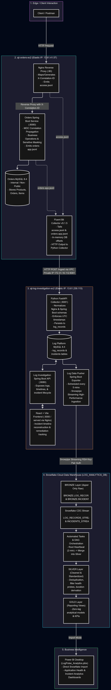

# DevOps Capstone Project: LogPulse Platform

LogPulse is an end-to-end distributed observability, log investigation, and analytical platform deployed across AWS EC2 instances, Snowflake Cloud Data Warehouse, and Power BI.
The system captures end-to-end request traces across microservices with distributed correlation IDs, streams structured logs in real time via Fluent Bit and Python FastAPI into an incident management platform, and synchronizes telemetry into Snowflake using Snowpipe Streaming.
Through automated Medallion CDC pipelines (Bronze -> Silver -> Gold), data is continuously transformed to empower real-time system diagnostics, incident remediation, and interactive Power BI operational dashboards.

## Architecture Diagram

## Documentation & Repository Structure

### Documentation
- **`Documentation/Raw`**: Contains raw documentation made during the development, testing, and deployment phases.
- **`Documentation`**: Contains refined documentation with improved phrasing, structure, and comprehensive technical guides.

### Application
- **`Application`**: Contains the application source code.
  - Aside from this repository, two applications are maintained in an external GitHub repository:
    - 🔗 **[log-investigation-app](https://github.com/sujit-t-k/log-investigation-app)** (contains `aji-log-investigation-frontend` and `aji-log-investigation-backend`).

### Snowflake
- **`Snowflake`**: Contains Snowflake queries in order to create a database structure and automated pipelines that clean and transform data through a multi-tier Medallion architecture (Bronze -> Silver -> Gold).

### Power BI
- **`Power BI`**: Contains the `.pbix` analytical file (`LogPulse_Analytics.pbix`).
- **`Power BI/dashboard illustrations`**: Contains dashboard preview illustrations and exported report visualizations.